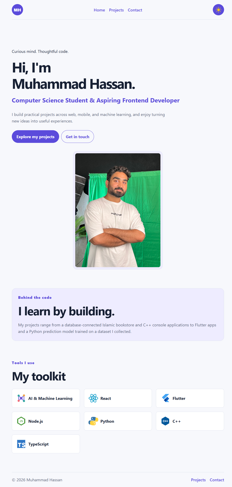

# Muhammad Hassan - Developer Portfolio

A responsive portfolio website introducing me, showcasing my projects, and providing a contact form.

## Preview

## Pages

- **Home:** Introduction, profile photo, skills, and links to the other pages.
- **Projects:** Six project cards rendered from JavaScript data, with title search and technology filtering.
- **Contact:** Accessible contact form with client-side field validation.

## Built with

- HTML5 for the page structure and content.
- CSS3 for responsive layouts, Flexbox, Grid, and light/dark themes.
- JavaScript for project rendering, search and filtering, theme preference, and form validation.

## Run locally

Open `index.html` in a browser. Use the navigation links to view the Projects and Contact pages.

## Live website

GitHub Pages deployment is not active yet. The live URL will be added here after the site is published.
